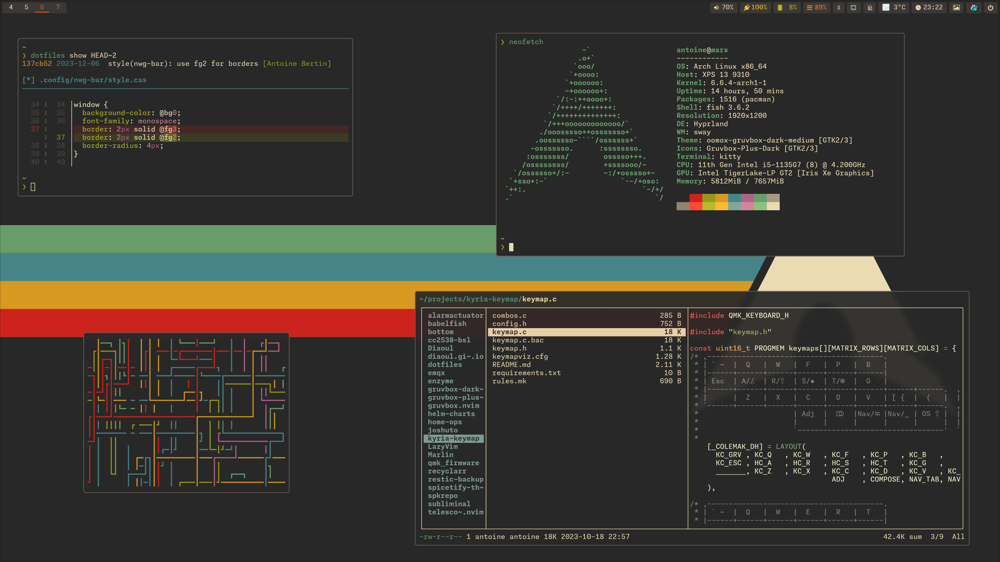

_I use Arch, btw._


## :camera_flash: Screenshots

_More in [screenshots](/screenshots)!_



## :package: Installation

With the [git bare](https://www.atlassian.com/git/tutorials/dotfiles) method
and [git sparse-checkout](https://git-scm.com/docs/git-sparse-checkout) to
ignore certain files.

```fish
git clone --bare https://github.com/Diaoul/dotfiles.git ~/.dotfiles
alias dotfiles "git --git-dir=$HOME/.dotfiles --work-tree=$HOME"
dotfiles config --local status.showUntrackedFiles no
dotfiles config --local remote.origin.fetch "+refs/heads/*:refs/remotes/origin/*"
dotfiles sparse-checkout set --no-cone "/*" "!/.github/"
dotfiles checkout

mise install
GIT_DIR=$HOME/.dotfiles GIT_WORK_TREE=$HOME lefthook install
```

If `dotfiles checkout` refuses to overwrite pre-existing files (e.g. a stock
`.bashrc`), move them out of the way and retry, or use `dotfiles checkout -f`.

## :art: Style

I love [Rosé Pine](https://rosepinetheme.com/) :heart: and use it everywhere:
GTK, icons, cursors, Hyprland, Noctalia, Neovim, fish, tmux and k9s.

### Font

Currently, I use [Maple Mono](https://github.com/subframe7536/maple-font) Nerd
Font but I switch regularly when I get too bored!

See my [fontconfig](.config/fontconfig/fonts.conf) for more details and
alternatives.

There are other nice looking fonts [out](https://terminal.sexy/)
[there](https://www.programmingfonts.org/).

### GTK, icons and cursors

- GTK theme and icons from [rose-pine-gtk](https://github.com/rose-pine/gtk)
- [rose-pine-hyprcursor](https://github.com/ndom91/rose-pine-hyprcursor) for
  Hyprland and BreezeX-RosePine for XWayland and other XCursor clients

To preview and apply those, I run `nwg-look`.

### Spotify

I use [`spotify-player`](https://github.com/aome510/spotify-player) in the
terminal.

## :hammer_and_wrench: System

### Display Manager

Running [ly](https://codeberg.org/fairyglade/ly), a TUI display manager.

### Window Manager

Previously on [bspwm](https://github.com/baskerville/bspwm), I now trust
[Hyprland](https://github.com/hyprwm/Hyprland) on Wayland for my tiling window
management needs, configured in Lua and started through
[uwsm](https://github.com/Vladimir-csp/uwsm).

Workspaces are dynamic and per monitor: directional binds step through the
workspaces of the focused monitor and open a single empty one past the last.

### Shell

[Noctalia](https://noctalia.dev/) provides the bar, launcher (including emoji
and clipboard history), notifications, OSD, session menu, lock screen and night
light, with a couple of [custom plugins](.local/share/noctalia/plugins).

[awww](https://github.com/LGFae/swww) draws the wallpaper and
[hypridle](https://github.com/hyprwm/hypridle) handles dimming, locking and
suspend.

### File Manager

Running [Thunar](https://docs.xfce.org/xfce/thunar/start) with a few plugins:

- thunar-archive-plugin
- thunar-media-tags-plugin
- thunar-volman
- tumbler
- raw-thumbnailer
- tumbler-stl-thumbnailer

### Terminal emulators

I run [Ghostty](https://ghostty.org/) because I'm a sucker for ligatures.

I also keep a config for [Kitty](https://sw.kovidgoyal.net/kitty/), just in
case.

### Tools

_Amazing tools I use all the time!_

- [eza](https://github.com/eza-community/eza) as a replacement for `ls`
- [bat](https://github.com/sharkdp/bat) instead of `cat` (with wings)
- [delta](https://github.com/dandavison/delta): `diff` with style
- [fd](https://github.com/sharkdp/fd) as a `find` alternative
- [ripgrep](https://github.com/BurntSushi/ripgrep) to kill old `grep`
- [fzf](https://github.com/junegunn/fzf) the fuzzy finder
- [starship](https://starship.rs/) ok this is not a tool but a cool prompt!
- [direnv](https://direnv.net/) for per-project environment
- [zoxide](https://github.com/ajeetdsouza/zoxide) to jump around directories
- [mise](https://mise.jdx.dev/) to manage tool versions
- [tmux](https://github.com/tmux/tmux) for sessions that survive

## :gear: System configuration

### Font

From the [arch wiki](https://wiki.archlinux.org/index.php/Font_configuration).

```fish
ln -s /usr/share/fontconfig/conf.avail/09-autohint-if-no-hinting.conf /etc/fonts/conf.d/
ln -s /usr/share/fontconfig/conf.avail/10-sub-pixel-rgb.conf /etc/fonts/conf.d/
ln -s /usr/share/fontconfig/conf.avail/11-lcdfilter-default.conf /etc/fonts/conf.d/
# if you don't plan to use bitmap fonts
ln -s /usr/share/fontconfig/conf.avail/70-no-bitmaps.conf /etc/fonts/conf.d/
```

## :handshake: Thanks

I took inspiration from all over the internet. Feel free to poke around!

Logo courtesy of [jglovier](https://github.com/jglovier/dotfiles-logo)
